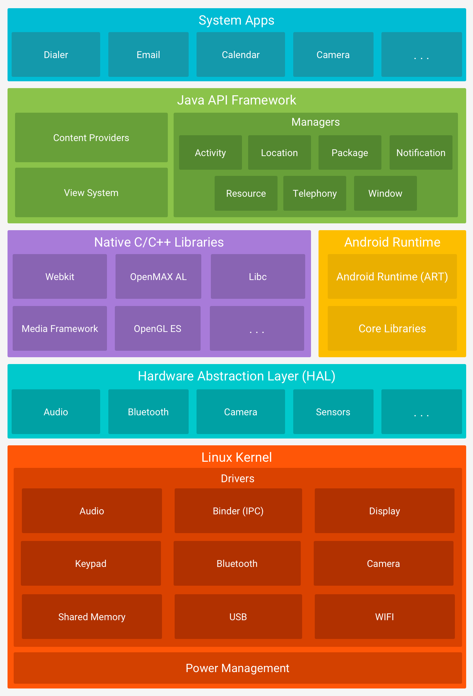

# Android

Android es un sistema operativo basado en un kernel Linux modificado, usado principalmente en dispositivos móviles. No es una distribución GNU/Linux, porque no usa las bibliotecas ni las herramientas de GNU.

## Dispositivos

Su desarrollo se ha extendido a otros tipos de dispositivos:

- **Televisores:** Android TV, hoy integrado en Google TV.
- **Coches:** Android Automotive OS, el sistema que lleva el propio vehículo. No debe confundirse con Android Auto, que proyecta el teléfono en la pantalla del coche.
- **Wearables (relojes):** Wear OS.
- **Realidad extendida (gafas y cascos):** Android XR.

También existen variantes y proyectos para otros equipos:

- **Portátiles y PC:** proyectos como Android-x86. Los Chromebook usan ChromeOS, que puede ejecutar aplicaciones Android pero no es Android.
- **Cámaras:** por ejemplo, la Samsung Galaxy Camera.
- **Consolas:** por ejemplo, Nvidia Shield.

## Historia

Android fue desarrollado inicialmente por Android Inc., fundada en 2003. Google la adquirió en 2005.

El 5 de noviembre de 2007 se presentó la plataforma Android junto con la creación de la Open Handset Alliance (OHA), poco después de la presentación del iPhone en enero de ese año. Android se planteó como una plataforma abierta, cuyo código se distribuye a través del AOSP (Android Open Source Project).

El primer teléfono comercial con Android, el HTC Dream (T-Mobile G1), salió en octubre de 2008.

## Open Handset Alliance (OHA)

La OHA es un consorcio de empresas de hardware, software y telecomunicaciones. Se creó el 5 de noviembre de 2007 con [34 miembros fundadores](https://openhandsetalliance.com/press_110507.html), entre ellos Google, HTC, Intel, LG, Motorola, Nvidia, Samsung, Qualcomm, T-Mobile y Telefónica. Entre sus miembros figuran también Sony y Dell, que no estaban entre los fundadores.

Sus miembros se comprometen por contrato a no fabricar dispositivos con *forks* de Android que compitan con él.

## AOSP y servicios de Google

El AOSP es el código abierto de Android, con licencia Apache 2.0 (salvo el kernel, que es GPL). Los servicios de Google (Play Store, Maps, etc.) no forman parte del AOSP y son propietarios.

Desde 2026, Google publica el código del AOSP solo dos veces al año, en el segundo y el cuarto trimestre, en lugar de cuatro. La licencia sigue siendo Apache 2.0.

## Arquitectura de la plataforma

Android se organiza en cinco capas, de las aplicaciones al kernel de Linux. Cada capa usa los servicios de la inferior.

| Capa | Contenido |
|---|---|
| **Aplicaciones** | Home, Contacts, Phone, Browser y el resto de apps. |
| **Framework de aplicaciones** (API en Java y Kotlin) | Activity Manager, Window Manager, Content Providers, View System, Notification Manager, Package Manager, Telephony Manager, Resource Manager y Location Manager. |
| **Bibliotecas nativas (C/C++)** y **Android Runtime** | Bibliotecas: Surface Manager, Media Framework, SQLite, OpenGL / Vulkan, FreeType, WebView, Skia, BoringSSL y Bionic (libc). Runtime: Core Libraries y ART. |
| **HAL** (capa de abstracción de hardware) | Interfaces estándar entre el framework y los controladores de cada fabricante. |
| **Kernel de Linux** | Controladores (pantalla, cámara, Bluetooth, Wi-Fi, USB, audio), Binder (IPC) y gestión de energía. |

Respecto al esquema clásico de las primeras versiones, ART sustituye a Dalvik (desde Android 5.0, en 2014) y aparece la capa HAL. Además, el navegador integrado (WebView) pasa a basarse en Chromium en lugar de WebKit.

