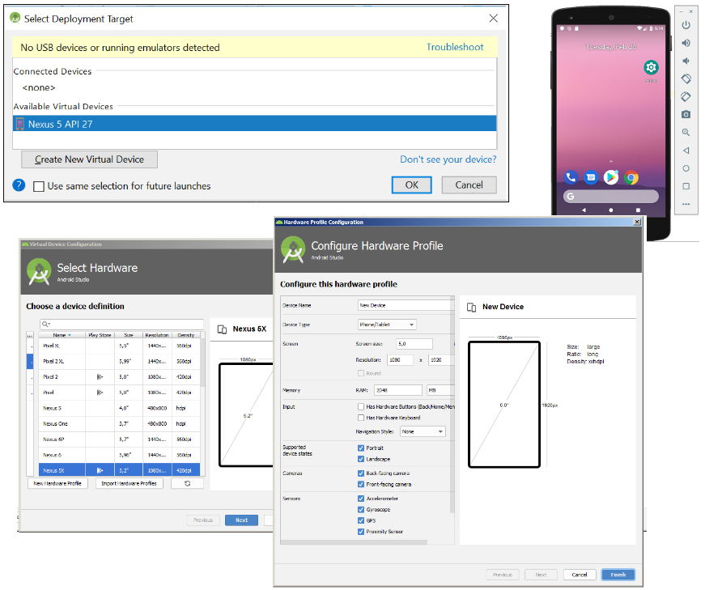

## AVD Manager

El gestor AVD (*Android Virtual Devices*) nos permite, de una manera gráfica, crear y gestionar distintos dispositivos Android necesarios para poder testear nuestras aplicaciones.

Podremos emular multitud de características en distintos dispositivos de una manera sencilla. Entre las características que podemos configurar se encuentran:

- Versión del S.O.
- Tamaño de memoria RAM.
- Soporte y tamaño de tarjeta SD.
- Tamaños y densidades de pantalla.
- Soporte de trackball, teclado, GPS, acelerómetro, grabación de audio, etc.

Antiguamente los AVD creados funcionaban perfectamente pero eran muy lentos, por lo que a menudo se utilizaban otras alternativas más rápidas, como puede ser el [emulador Genymotion](http://www.genymotion.com/), proporcionado como una máquina virtual de VirtualBox.