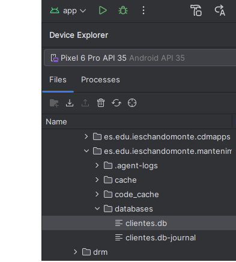

# ADB (Android Debug Bridge)

## ¿Qué es ADB?

**ADB (Android Debug Bridge)** es una utilidad de línea de comandos que permite comunicarnos con un dispositivo Android conectado al equipo, ya sea un dispositivo físico o un emulador.

ADB forma parte de las herramientas de desarrollo del SDK de Android y se encuentra en la carpeta `platform-tools`.

Si vamos a trabajar habitualmente con esta utilidad, es recomendable añadir dicha carpeta a la variable de entorno `PATH` del sistema. De esta manera, podremos ejecutar sus comandos desde cualquier terminal sin necesidad de indicar su ruta completa.

Aunque lo habitual es trabajar con dispositivos virtuales (AVD o similares), también podemos trabajar con dispositivos físicos conectados mediante un cable USB, o incluso establecer una conexión inalámbrica mediante Wi-Fi.

## Comandos básicos de ADB

Para comprobar que ADB está instalado y conocer los comandos disponibles, podemos ejecutar:

``` bash
adb
```

Para consultar la versión instalada:

``` bash
adb version
```

Para obtener la ayuda completa:

``` bash
adb --help
```

### Selección del dispositivo

Cuando tenemos varios dispositivos conectados simultáneamente, podemos indicar a qué dispositivo queremos enviar los comandos:

| Opción | Descripción |
|---|---|
| `-d` | Dirige el comando al único dispositivo físico conectado por USB. |
| `-e` | Dirige el comando al único emulador en ejecución. |
| `-s <serial>` | Selecciona un dispositivo o emulador mediante su número de serie. |

Para consultar los dispositivos conectados:

``` bash
adb devices
```

Ejemplo de salida:

``` text
List of devices attached
04c3ae8ddc5bd06a        device
192.168.56.101:5555     device
```

Si queremos trabajar con uno de ellos, utilizaremos su identificador:

``` bash
adb -s 192.168.56.101:5555 shell
```

También podemos establecer el dispositivo predeterminado mediante la variable de entorno `ANDROID_SERIAL`.

En Windows:

``` cmd
set ANDROID_SERIAL=192.168.56.101:5555
```

A partir de ese momento, podremos ejecutar directamente:

``` bash
adb shell
```

La opción `-s` tiene prioridad sobre la variable `ANDROID_SERIAL`.

ADB también permite trabajar con un dispositivo Android sin necesidad de mantenerlo conectado mediante USB utilizando una conexión Wi-Fi.

## Comandos habituales de ADB

ADB dispone de numerosos comandos para interactuar con el dispositivo. Los más utilizados son los siguientes:

| Comando | Descripción |
|---|---|
| `adb devices` | Lista los dispositivos conectados. |
| `adb connect <host>:<port>` | Conecta con un dispositivo mediante TCP/IP. |
| `adb disconnect` | Desconecta los dispositivos conectados mediante TCP/IP. |
| `adb shell` | Abre una consola de comandos en Android. |
| `adb push <local> <remote>` | Copia archivos del ordenador al dispositivo. |
| `adb pull <remote> <local>` | Copia archivos del dispositivo al ordenador. |
| `adb install <archivo.apk>` | Instala una aplicación. |
| `adb uninstall <paquete>` | Desinstala una aplicación. |
| `adb logcat` | Muestra los registros del sistema y de las aplicaciones. |
| `adb bugreport` | Genera información para diagnosticar problemas. |
| `adb reboot` | Reinicia el dispositivo. |
| `adb start-server` | Inicia el servidor ADB. |
| `adb kill-server` | Detiene el servidor ADB. |
| `adb get-state` | Muestra el estado de la conexión. |
| `adb get-serialno` | Muestra el número de serie del dispositivo. |

### Instalación y desinstalación de aplicaciones

Para instalar una aplicación:

``` bash
adb install aplicacion.apk
```

Para reinstalar una aplicación conservando sus datos:

``` bash
adb install -r aplicacion.apk
```

Para instalar un APK marcado como de prueba (`testOnly`):

``` bash
adb install -t aplicacion.apk
```

Para desinstalar una aplicación:

``` bash
adb uninstall com.empresa.app
```

### Transferencia de archivos

Podemos copiar archivos entre el ordenador y el dispositivo.

Para enviar un archivo:

``` bash
adb push archivo.txt /sdcard/archivo.txt
```

Para recuperar un archivo:

``` bash
adb pull /sdcard/archivo.txt archivo.txt
```

### Acceso a la consola del dispositivo

Uno de los comandos más interesantes es `shell`, que permite acceder a una consola del propio sistema Android.

``` bash
adb shell
```

También podemos ejecutar directamente un comando sin necesidad de abrir una sesión interactiva:

``` bash
adb shell ls /sdcard
```

Desde esta consola podemos utilizar diferentes comandos de Unix y herramientas disponibles en Android.

Entre las utilidades interesantes se encuentran:

-   `sqlite3`: permite trabajar con bases de datos SQLite.
-   `logcat`: permite consultar los registros del sistema.
-   `screenrecord`: permite grabar la actividad de la pantalla en
    dispositivos compatibles.

## Depuración USB y autorización del dispositivo

Para trabajar directamente con un dispositivo físico debemos habilitar previamente el **Modo de depuración USB** desde las opciones de desarrollador.

Al conectar el dispositivo por primera vez, Android puede mostrar un cuadro de diálogo solicitando autorización para permitir que ese ordenador se comunique mediante ADB.

Esta autorización se basa en una clave RSA y es un mecanismo de seguridad que impide que cualquier ordenador pueda ejecutar comandos ADB sin consentimiento.

Si ejecutamos:

``` bash
adb devices
```

y el dispositivo aparece con el estado `unauthorized`, debemos desbloquearlo y aceptar la solicitud de autorización que aparece en su pantalla.

Los estados más habituales son:

-   `device`: dispositivo conectado y autorizado.
-   `unauthorized`: el dispositivo todavía no ha autorizado al ordenador.
-   `offline`: el dispositivo no responde correctamente a la conexión ADB.

## Herramientas de Android Studio

Android Studio integra diferentes herramientas que facilitan la inspección y depuración de los dispositivos conectados.

### Device File Explorer

Una vez conectado el dispositivo mediante ADB, podemos utilizar **Device File Explorer** para explorar la estructura de carpetas y archivos del dispositivo.

Esta herramienta permite consultar y transferir archivos, respetando las restricciones de acceso del sistema Android.



### Database Inspector

Android Studio también incorpora **Database Inspector**, una herramienta que permite inspeccionar, consultar y modificar las bases de datos de una aplicación mientras está en ejecución.

Es compatible con SQLite y Room.

Para acceder a ella:

1.  Ejecutamos nuestra aplicación en un emulador o dispositivo conectado.
2.  Abrimos `View > Tool Windows > App Inspection`.
3.  Seleccionamos la pestaña `Database Inspector`.
4.  Elegimos el proceso de nuestra aplicación.
5.  Seleccionamos la base de datos que queremos inspeccionar.

Desde esta herramienta podemos consultar las tablas, ejecutar sentencias SQL y visualizar los cambios producidos en la base de datos.

**Nota:** Database Inspector requiere Android API 26 o superior y funciona con la implementación de SQLite incluida en el sistema Android.

## Generación de APK desde Android Studio

Cuando pulsamos el botón **Run** de Android Studio, el IDE compila e instala la aplicación en el dispositivo seleccionado.

El APK generado para esta ejecución puede incluir el atributo `testOnly="true"`, lo que significa que está destinado a instalaciones de prueba mediante ADB o Android Studio.

Si queremos generar un APK de depuración que pueda instalarse directamente, sin necesidad de utilizar ADB, debemos seguir estos pasos:

1.  Abrir la ventana `Build Variants`.
2.  Seleccionar la variante `debug`.
3.  Acceder al menú `Build`.
4.  Seleccionar `Build Bundle(s) / APK(s) > Build APK(s)`.

Una vez finalizada la compilación, Android Studio mostrará una notificación con acceso al APK generado.

Para distribuir una aplicación, debemos generar una versión de producción (`release`) y configurar su firma digital.

------------------------------------------------------------------------

# Acceso desde línea de comandos: sqlite3

## ¿Qué es sqlite3?

Desde la consola de ADB podemos acceder a `sqlite3`, una utilidad de línea de comandos que permite crear, consultar y gestionar bases de datos SQLite.

Esta herramienta resulta especialmente útil durante el desarrollo para inspeccionar la información almacenada por nuestras aplicaciones.

Para acceder a una base de datos necesitamos conocer previamente su ubicación.

En Android, las bases de datos privadas de una aplicación suelen encontrarse en:

``` text
/data/data/<nombre_del_paquete>/databases/
```

En versiones actuales también podemos encontrar esta ubicación mediante:

``` text
/data/user/0/<nombre_del_paquete>/databases/
```

## Conexión con el emulador

En primer lugar, establecemos la conexión con el emulador mediante ADB:

``` bash
adb connect 192.168.56.101:5555
```

Si la conexión se establece correctamente, obtendremos un mensaje similar a:

``` text
connected to 192.168.56.101:5555
```

A continuación, accedemos a la consola del dispositivo:

``` bash
adb shell
```

## Acceso a la base de datos

El acceso a las bases de datos privadas está restringido por Android.

En un emulador con permisos de root podemos acceder a ellas utilizando:

``` bash
su
```

Una vez obtenidos los permisos necesarios, nos desplazamos hasta el directorio de bases de datos:

``` bash
cd /data/data/com.empresa.app/databases
```

Podemos consultar su contenido:

``` bash
ls
```

Y abrir la base de datos utilizando `sqlite3`:

``` bash
sqlite3 bd.sqlite
```

Si todo funciona correctamente, aparecerá una salida similar a esta:

``` text
SQLite version 3.x.x
Enter ".help" for instructions
Enter SQL statements terminated with a ";"
sqlite>
```

**Importante:** En un dispositivo sin root, el acceso directo a `/data/data` está restringido. Para aplicaciones de depuración podemos utilizar `run-as` con el identificador del paquete, siempre que la
aplicación permita este acceso y esté compilada como depurable.

Por ejemplo:

``` bash
adb shell run-as com.empresa.app
```

Una vez dentro del contexto de la aplicación, podemos trabajar con sus archivos privados si disponemos de las herramientas y permisos necesarios.

## Trabajar con sqlite3

Una vez dentro de la consola de SQLite, podemos ejecutar dos tipos de instrucciones:

-   Comandos propios de SQLite, que **comienzan** con un punto (`.`).
-   Sentencias SQL, que normalmente **terminan** con punto y coma (`;`).

### Comandos básicos

| Comando | Descripción |
|---|---|
| `.help` | Muestra la ayuda. |
| `.databases` | Muestra las bases de datos abiertas. |
| `.tables` | Lista las tablas existentes. |
| `.schema` | Muestra la estructura de las tablas. |
| `.schema <tabla>` | Muestra la estructura de una tabla concreta. |
| `.dump` | Genera un volcado SQL de la base de datos. |
| `.indices` | Muestra los índices existentes. |
| `.header on` | Muestra los nombres de las columnas. |
| `.mode column` | Presenta los resultados en formato de columnas. |
| `.mode csv` | Presenta los resultados en formato CSV. |
| `.backup <archivo>` | Realiza una copia de seguridad. |
| `.restore <archivo>` | Restaura una copia de seguridad. |
| `.exit` | |               Sale de la consola.

### Consultar las tablas

Para listar las tablas existentes:

``` sql
.tables
```

Para consultar la estructura de una tabla:

``` sql
.schema usuarios
```

Para consultar todos los registros:

``` sql
SELECT * FROM usuarios;
```

Para mostrar los nombres de las columnas y mejorar la presentación:

``` sql
.headers on
.mode column
```

A continuación, podemos ejecutar:

``` sql
SELECT * FROM usuarios;
```
## Precauciones al trabajar con SQLite

Hay que tener especial cuidado al escribir el nombre de la base de datos, ya que en los sistemas Android los nombres de archivo distinguen entre mayúsculas y minúsculas.

Si indicamos un nombre de archivo que no existe, SQLite puede crear una base de datos nueva y vacía, en lugar de abrir la que pretendíamos consultar, y parecernos (erróneamente) que las tablas han desaparecido.

Por tanto, es recomendable comprobar previamente la existencia del archivo y su nombre exacto.