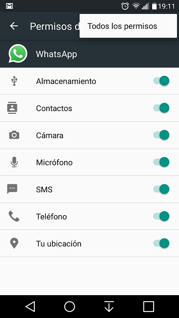

# Permisos en Android

Android ejecuta cada aplicación en un entorno aislado (*sandbox*). Esto significa que, por defecto, una aplicación no puede realizar operaciones que afecten a otras aplicaciones, al propio sistema operativo o a la privacidad del usuario.

Para controlar qué operaciones puede realizar cada aplicación, Android dispone de un **sistema de permisos**. Para que una aplicación utilice determinadas funcionalidades del sistema, debe **declarar** los permisos correspondientes en el archivo `AndroidManifest.xml`.

Por ejemplo:

```xml
<manifest ...>
    <!-- Permiso normal: el sistema lo concede al instalar la app -->
    <uses-permission android:name="android.permission.INTERNET" />

    <!-- Permiso peligroso: además de declararlo, hay que solicitarlo en ejecución -->
    <uses-permission android:name="android.permission.CAMERA" />
</manifest>
```

> **Ojo:** declarar un permiso en el manifiesto es necesario, pero **no siempre suficiente**. Si no se declara, no se puede solicitar ni obtener; si se declara un permiso peligroso, hay que pedirlo además al usuario en tiempo de ejecución.

## Tipos de permisos

Android clasifica los permisos según su **nivel de protección**, que determina cómo se conceden. La clasificación actual distingue tres tipos:

| Tipo | Nivel de protección | Cómo se concede | Ejemplos |
|---|---|---|---|
| **De instalación: normales** | `normal` | Automáticamente, al instalar la app | `INTERNET`, `VIBRATE`, `ACCESS_NETWORK_STATE` |
| **De instalación: de firma** | `signature` | Solo si la app está firmada con el mismo certificado que la app o el sistema que define el permiso | Permisos internos del sistema; servicios que solo el sistema puede enlazar |
| **En tiempo de ejecución (peligrosos)** | `dangerous` | El usuario los autoriza mediante un cuadro de diálogo | `CAMERA`, `READ_CONTACTS`, `ACCESS_FINE_LOCATION` |
| **Especiales** | `appop` | El usuario los activa en *Ajustes > Acceso especial de apps* | `SYSTEM_ALERT_WINDOW` (superponerse a otras apps), `REQUEST_INSTALL_PACKAGES` (instalar apps desconocidas) |

## Permisos normales

Los permisos normales dan acceso a datos o acciones que van más allá del *sandbox* de la app, pero con muy poco riesgo para la privacidad del usuario o para el funcionamiento de otras apps. El sistema los concede automáticamente y el usuario no tiene que aprobarlos.

Algunos ejemplos:

- `ACCESS_LOCATION_EXTRA_COMMANDS`
- `ACCESS_NETWORK_STATE`
- `ACCESS_NOTIFICATION_POLICY`
- `ACCESS_WIFI_STATE`
- `BROADCAST_STICKY`
- `CHANGE_NETWORK_STATE`
- `CHANGE_WIFI_MULTICAST_STATE`
- `CHANGE_WIFI_STATE`
- `DISABLE_KEYGUARD`
- `EXPAND_STATUS_BAR`
- `FOREGROUND_SERVICE` (desde Android 9, API 28)
- `GET_PACKAGE_SIZE`
- `INTERNET`
- `KILL_BACKGROUND_PROCESSES`
- `MODIFY_AUDIO_SETTINGS`
- `NFC`
- `READ_SYNC_SETTINGS`
- `READ_SYNC_STATS`
- `RECEIVE_BOOT_COMPLETED`
- `REORDER_TASKS`
- `REQUEST_IGNORE_BATTERY_OPTIMIZATIONS`
- `SET_ALARM` (nombre completo: `com.android.alarm.permission.SET_ALARM`)
- `SET_TIME_ZONE`
- `SET_WALLPAPER`
- `SET_WALLPAPER_HINTS`
- `TRANSMIT_IR`
- `USE_BIOMETRIC` (desde Android 9, API 28)
- `VIBRATE`
- `WAKE_LOCK`
- `WRITE_SYNC_SETTINGS`

## Permisos peligrosos

Los permisos peligrosos dan acceso a datos personales o a funcionalidades sensibles del dispositivo. Desde Android 6.0 deben solicitarse al usuario en tiempo de ejecución.

### Principales permisos peligrosos por ámbito


| Ámbito | Permisos | Notas |
|---|---|---|
| Calendario | `READ_CALENDAR`, `WRITE_CALENDAR` | |
| Registro de llamadas | `READ_CALL_LOG`, `WRITE_CALL_LOG` | Restringidos (ver «Tipos de permisos»). `PROCESS_OUTGOING_CALLS` está obsoleto desde Android 10 (API 29): usa `CallRedirectionService`. |
| Cámara | `CAMERA` | Capturar una foto delegando en la app de cámara mediante un *intent* no requiere el permiso. |
| Contactos | `READ_CONTACTS`, `WRITE_CONTACTS`, `GET_ACCOUNTS` | |
| Ubicación | `ACCESS_COARSE_LOCATION` (aproximada), `ACCESS_FINE_LOCATION` (precisa), `ACCESS_BACKGROUND_LOCATION` | El permiso de segundo plano existe desde Android 10 (API 29). Desde Android 12, la precisa debe solicitarse junto con la aproximada. |
| Micrófono | `RECORD_AUDIO` | |
| Teléfono | `READ_PHONE_STATE`, `READ_PHONE_NUMBERS`, `CALL_PHONE`, `ADD_VOICEMAIL`, `USE_SIP` | Desde Android 11, para leer el número de línea hay que pedir `READ_PHONE_NUMBERS` en lugar de `READ_PHONE_STATE`. |
| Actividad física | `ACTIVITY_RECOGNITION` | Desde Android 10 (API 29). |
| Sensores corporales | `BODY_SENSORS`, `BODY_SENSORS_BACKGROUND` | En apps con *target* Android 16 o superior se sustituyen por permisos de `android.permission.health.*` (p. ej. `READ_HEART_RATE`). |
| SMS | `SEND_SMS`, `RECEIVE_SMS`, `READ_SMS`, `RECEIVE_WAP_PUSH`, `RECEIVE_MMS` | Restringidos (ver «Tipos de permisos»). |
| Almacenamiento y multimedia | `READ_MEDIA_IMAGES`, `READ_MEDIA_VIDEO`, `READ_MEDIA_AUDIO`, `READ_MEDIA_VISUAL_USER_SELECTED`, `READ_EXTERNAL_STORAGE` (heredado) | Ver «Almacenamiento» más abajo. |
| Dispositivos cercanos | `BLUETOOTH_SCAN`, `BLUETOOTH_CONNECT`, `BLUETOOTH_ADVERTISE` (Android 12), `NEARBY_WIFI_DEVICES` (Android 13), `ACCESS_LOCAL_NETWORK` (Android 17) | Pertenecen al grupo `NEARBY_DEVICES`. |
| Notificaciones | `POST_NOTIFICATIONS` | Desde Android 13 (API 33). |

> **Importante:** esta tabla es una referencia didáctica, no una lista cerrada. Android añade permisos y cambia su organización entre versiones. Consulta siempre la referencia oficial de `Manifest.permission`.

### Almacenamiento

El almacenamiento es el ámbito que más ha cambiado:

- **Android 10 (API 29):** almacenamiento con ámbito (*scoped storage*). Las apps ya no necesitan permisos de almacenamiento para añadir sus propios archivos al almacenamiento compartido.
- **Android 11 (API 30):** en apps con *target* 30 o superior, `WRITE_EXTERNAL_STORAGE` deja de tener efecto. Para acceso amplio a archivos existe el permiso especial `MANAGE_EXTERNAL_STORAGE` («Acceso a todos los archivos»), pensado solo para casos muy concretos.
- **Android 13 (API 33):** `READ_EXTERNAL_STORAGE` se sustituye, para acceder a archivos multimedia de otras apps, por permisos granulares: `READ_MEDIA_IMAGES`, `READ_MEDIA_VIDEO` y `READ_MEDIA_AUDIO`. Si se piden imágenes y vídeos a la vez, el sistema muestra un único cuadro de diálogo.
- **Android 14 (API 34):** el usuario puede conceder acceso solo a **fotos y vídeos seleccionados**. Las apps con su propio selector de galería deben contemplar el permiso `READ_MEDIA_VISUAL_USER_SELECTED`.

Si solo necesitas que el usuario elija imágenes o vídeos, el **selector de fotos del sistema** (*photo picker*) permite hacerlo sin solicitar ningún permiso de almacenamiento.

## Evolución de los permisos por versión de Android

| Versión (API) | Cambio relevante |
|---|---|
| 6.0 (23) | Aparece el modelo de permisos en tiempo de ejecución. |
| 9 (28) | `USE_FINGERPRINT` queda obsoleto; se añade `USE_BIOMETRIC`. |
| 10 (29) | Permiso de ubicación «solo mientras se usa la app» y `ACCESS_BACKGROUND_LOCATION`; `ACTIVITY_RECOGNITION`; permisos restringidos; almacenamiento con ámbito. |
| 11 (30) | Permisos de un solo uso; restablecimiento automático de permisos en apps sin usar; tras denegar dos veces, el sistema deja de mostrar el diálogo. |
| 12 (31) | Ubicación aproximada o precisa a elección del usuario; nuevos permisos de Bluetooth. |
| 13 (33) | `POST_NOTIFICATIONS`, `NEARBY_WIFI_DEVICES` y permisos multimedia granulares. |
| 14 (34) | Acceso a fotos y vídeos seleccionados. Se impide instalar apps con `targetSdkVersion` inferior a 23. |
| 16 (36) | `BODY_SENSORS` se sustituye por permisos de salud granulares (apps con *target* 36 o superior). |
| 17 (37) | Nuevo permiso `ACCESS_LOCAL_NETWORK` para acceder a dispositivos de la red local (obligatorio en apps con *target* 37 o superior). |

## Modelos de gestión de permisos en Android

La gestión de los permisos cambió significativamente con Android 6.0 Marshmallow (API 23): se pasó del modelo de permisos **en tiempo de instalación** (*install-time*) al modelo **en tiempo de ejecución** (*runtime*).

Conviene distinguir dos factores que no son lo mismo:

- La **versión de Android** del dispositivo donde se ejecuta la app.
- El **`targetSdkVersion`** de la app, es decir, para qué versión de la API fue construida.

### Android 5.1 Lollipop (API 22) e inferiores

En dispositivos con Android 5.1 o inferior:

- El sistema solicita los permisos durante la instalación de la aplicación.
- Se muestran los **grupos** de permisos, no los permisos individuales.
- Si una actualización añade nuevos permisos, el sistema puede solicitar su aceptación durante la actualización.
- El usuario no puede revocar permisos individuales desde los ajustes: para retirarlos tiene que desinstalar la aplicación.
- Los fabricantes y operadores podían preinstalar aplicaciones con permisos ya concedidos, sin avisar al usuario.

**Aplicaciones antiguas en dispositivos modernos.** Una app con `targetSdkVersion` 22 o inferior instalada en Android 6.0 o superior sigue recibiendo sus permisos en el momento de la instalación, pero el usuario **sí puede revocarlos después** desde los ajustes, independientemente del nivel de API de la app. Por eso estas apps deben tolerar que un permiso desaparezca en cualquier momento.

Este escenario es cada vez menos frecuente: desde Android 14 no se pueden instalar apps con `targetSdkVersion` inferior a 23 (y Android 15 elevó el mínimo a 24). Se hizo precisamente porque el malware aprovechaba los niveles de API antiguos para evitar el modelo de permisos en ejecución.

### Android 6.0 Marshmallow (API 23) y superiores

Con Android 6.0 se introdujo el modelo de permisos en tiempo de ejecución. Sus principales características son:

- Los permisos peligrosos se solicitan cuando la aplicación necesita utilizarlos, no durante la instalación.
- El usuario puede conceder o denegar cada solicitud.
- El usuario puede modificar los permisos concedidos en cualquier momento desde los ajustes del dispositivo.
- La aplicación debe **comprobar que dispone del permiso cada vez** que realiza una operación que lo requiere. No debe suponer que, por haberlo obtenido antes, lo sigue teniendo.

Con el tiempo se han añadido más controles para el usuario:

- **Permisos de un solo uso** (Android 11): para ubicación, micrófono y cámara, el cuadro de diálogo incluye la opción *Solo esta vez*.
- **Restablecimiento automático**: si una app que apunta a Android 11 o superior no se usa durante varios meses, el sistema restablece sus permisos sensibles. Google extendió esta función a dispositivos con Android 6.0 o superior y Google Play services.
- **Denegación repetida** (Android 11): si el usuario deniega un permiso más de una vez, el sistema deja de mostrar el diálogo cuando la app vuelva a pedirlo.
- **Ubicación aproximada** (Android 12): el usuario puede conceder solo la ubicación aproximada aunque la app pida la precisa.

Esto implica que la programación se complica, ya que hay que gestionar tanto la concesión como la denegación de los permisos, y que la app debe seguir funcionando (con funcionalidad reducida) cuando el usuario los deniega. A cambio, el usuario controla mucho mejor su privacidad.



### Flujo recomendado para solicitar un permiso

1. Comprobar si la app ya tiene el permiso.
2. Si no lo tiene y el sistema recomienda explicarlo (`shouldShowRequestPermissionRationale`), mostrar una explicación clara de por qué se necesita.
3. Solicitar el permiso.
4. Gestionar la respuesta: si se concede, continuar; si se deniega, degradar la funcionalidad con elegancia.

La forma recomendada de solicitarlo es el contrato `RequestPermission` de la API *Activity Result*, que gestiona por ti el código de la solicitud:

```kotlin
// Se registra una sola vez, al inicializar la Activity o el Fragment
private val requestContacts =
    registerForActivityResult(ActivityResultContracts.RequestPermission()) { granted ->
        if (granted) readContacts() else showFeatureUnavailable()
    }

private fun onImportContactsClicked() {
    when {
        ContextCompat.checkSelfPermission(this, Manifest.permission.READ_CONTACTS)
                == PackageManager.PERMISSION_GRANTED -> readContacts()

        shouldShowRequestPermissionRationale(Manifest.permission.READ_CONTACTS) ->
            showRationaleDialog { requestContacts.launch(Manifest.permission.READ_CONTACTS) }

        else -> requestContacts.launch(Manifest.permission.READ_CONTACTS)
    }
}
```

La aplicación no puede personalizar el cuadro de diálogo del sistema; lo único que controla es la explicación previa.

### Buenas prácticas

- **Pide el mínimo imprescindible.** Muchos casos de uso (hacer una foto con la app de cámara, elegir una imagen con el selector del sistema…) no requieren ningún permiso.
- **Pídelo en contexto**, lo más tarde posible: cuando el usuario inicia la acción que lo necesita, no al arrancar la app.
- **Sé transparente:** explica qué datos usas, para qué y qué funciones se pierden si se deniega.
- **Degrada con elegancia** y nunca bloquees al usuario: debe poder cancelar cualquier pantalla explicativa.
- **Revisa las dependencias:** al incluir una biblioteca heredas los permisos que declare.

### Relación entre permisos y grupos

Los permisos peligrosos se organizan en **grupos** de permisos relacionados (por ejemplo, `READ_CONTACTS` y `WRITE_CONTACTS` pertenecen al grupo de contactos). La finalidad del grupo es reducir el número de diálogos que ve el usuario cuando una app pide permisos estrechamente relacionados.

En las primeras versiones del modelo en ejecución, si ya se había concedido un permiso de un grupo, otros permisos del mismo grupo podían concederse sin mostrar un nuevo diálogo. Por ejemplo, con `READ_CONTACTS` concedido, la app podía obtener `WRITE_CONTACTS` sin nueva solicitud.

**Importante:** este comportamiento **no debe usarse como regla** en aplicaciones actuales. Android puede cambiar un permiso de grupo sin previo aviso, por lo que no se debe asumir que conceder un permiso implique conceder otros del mismo grupo, ni depender de la estructura de los grupos. Hay que comprobar y solicitar individualmente cada permiso que se necesite.

## Resumen

| Característica | Modelo de instalación | Modelo de ejecución |
|---|---|---|
| Aplicable cuando… | El dispositivo usa Android 5.1 (API 22) o inferior | El dispositivo usa Android 6.0 (API 23) o superior y la app lo soporta (`targetSdkVersion` 23 o superior) |
| Momento de solicitud | Durante la instalación | Cuando la aplicación necesita el permiso |
| Decisión del usuario | Aceptar todo al instalar | Concede o deniega cada solicitud (y puede cambiarla después) |
| Revocación | No se permite individualmente en Android 5.1 o inferior. En Android 6.0 o superior **sí se puede**, incluso en apps antiguas | Se gestiona desde los ajustes del dispositivo |
| Comprobación en el código | No era necesaria | Es necesario comprobar el permiso antes de cada uso |

**Conclusión:** el modelo de permisos en ejecución proporciona un mayor control sobre la privacidad del usuario y obliga a los desarrolladores a gestionar correctamente la concesión y la denegación de los permisos durante la ejecución de sus aplicaciones. Android sigue evolucionando en esa dirección (permisos más granulares, de un solo uso o limitados a lo que el usuario selecciona), por lo que conviene revisar la documentación oficial al apuntar a cada nueva versión de la API.