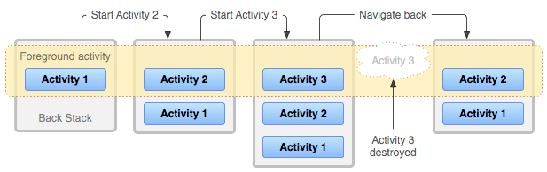

# Actividades

Una actividad (`Activity`) es el componente de la aplicación que representa **una pantalla con la que el usuario interactúa**. Una aplicación suele tener varias, que trabajan juntas.

## Actividad principal

Una de las actividades se denomina **actividad principal**. Se marca en el manifiesto con la acción `MAIN` y la categoría `LAUNCHER`, y es la que se abre cuando el usuario inicia la aplicación (por ejemplo, tocando su icono).

## Tarea y pila de actividades

Una **tarea** (*task*) es el conjunto de actividades con las que el usuario realiza una acción. Sus actividades se guardan en una **pila de actividades** (*back stack*), en el orden en que se van abriendo.

Cuando una actividad inicia otra:

- La nueva pasa a **primer plano**, en la cima de la pila.
- La anterior se queda **en la pila**, sin destruirse, y conserva el estado de su interfaz (por ejemplo, la posición de desplazamiento o el texto escrito en un formulario).
  - Si la nueva actividad la tapa por completo, la anterior queda **detenida**.
  - Si solo la cubre en parte (una actividad translúcida o un diálogo), queda **en pausa**.

Cuando el usuario pulsa **Atrás** (botón o gesto), la actividad actual se **destruye**, se saca de la pila y se **reanuda** la anterior. El estado de una actividad destruida no se conserva automáticamente.

La pila es **LIFO** (*Last In, First Out*: el último en entrar es el primero en salir), como se observa en la siguiente figura:



*Fuente: [Tareas y pila de actividades](https://developer.android.com/guide/components/tasks-and-back-stack), documentación de Android Developers.*

> **Cambios recientes en el botón Atrás**
>
> - **Android 12 o superior:** en la actividad raíz (la que declara `MAIN` y `LAUNCHER`), Atrás ya **no la finaliza**: mueve la actividad y su tarea a segundo plano, igual que Home.
> - **Android 16 o superior** (apps con target API 36 o superior): se activan por defecto las animaciones del *gesto Atrás predictivo*, y ya no se llama a `onBackPressed()` ni se envía `KEYCODE_BACK`. Para personalizar el comportamiento de Atrás hay que usar las API de AndroidX Activity (por ejemplo, `OnBackPressedCallback`).

## Cómo se crea una actividad

1. Se crea una clase que **herede** (directa o indirectamente) de `Activity`; en la práctica, suele heredarse de una subclase como `AppCompatActivity`.
2. Se **declara en el manifiesto** (`<activity>`). Sin esa declaración, el sistema no puede iniciarla.
3. No se crea con `new`: es el **sistema** quien instancia la actividad cuando se inicia con un `Intent`.

En la clase se **sobrescriben los métodos *callback*** que el sistema llama automáticamente cuando cambia el estado de la actividad a lo largo de su ciclo de vida. El básico es `onCreate()`, donde se hace la inicialización y, normalmente, se carga el diseño de la pantalla con `setContentView()`. El resto solo hay que sobrescribirlos cuando haga falta.

## Activity es un Context

En la jerarquía de clases, `Activity` hereda de `Context`:

```
java.lang.Object
 └─ android.content.Context
     └─ android.content.ContextWrapper
         └─ android.view.ContextThemeWrapper
             └─ android.app.Activity
```

`Context` es una **clase abstracta** cuya implementación proporciona el sistema operativo. Da acceso a los elementos del entorno de ejecución de la aplicación: recursos, servicios del sistema, iniciar otras actividades, enviar difusiones, archivos, etc.

Es importante saber que **una actividad es un contexto**, porque muchos métodos reciben el contexto como parámetro para poder ejecutar su código, y en ellos se puede pasar la propia actividad.