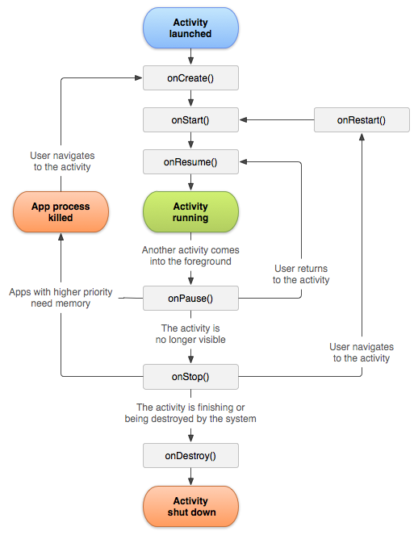

# Actividades

*Documentación de Android Developers: [Introducción a las actividades](https://developer.android.com/guide/components/activities/intro-activities?hl=es)*

Una actividad (`Activity`) es el componente de la aplicación que representa **una pantalla con la que el usuario interactúa**. Una aplicación suele tener varias, que trabajan juntas.

## Actividad principal

Una de las actividades se denomina **actividad principal**. Se marca en el manifiesto con la acción `MAIN` y la categoría `LAUNCHER`, y es la que se abre cuando el usuario inicia la aplicación (por ejemplo, tocando su icono).

## Tarea y pila de actividades

Una **tarea** (*task*) es el conjunto de actividades con las que el usuario realiza una acción. Sus actividades se guardan en una **pila de actividades** (*back stack*), en el orden en que se van abriendo.

Cuando una actividad inicia otra:

- La nueva pasa a **primer plano**, en la cima de la pila.
- La anterior se queda **en la pila**, sin destruirse, y conserva el estado de su interfaz (por ejemplo, la posición de desplazamiento o el texto escrito en un formulario).
  - Si la nueva actividad la tapa por completo, la anterior queda **detenida**.
  - Si solo la cubre en parte (una actividad translúcida o un diálogo), queda **en pausa**.

Cuando el usuario pulsa **Atrás** (botón o gesto), la actividad actual se **destruye**, se saca de la pila y se **reanuda** la anterior. El estado de una actividad destruida no se conserva automáticamente.

La pila es **LIFO** (*Last In, First Out*: el último en entrar es el primero en salir), como se observa en la siguiente figura:


> **Cambios recientes en el botón Atrás**
>
> - **Android 12 o superior:** en la actividad raíz (la que declara `MAIN` y `LAUNCHER`), Atrás ya **no la finaliza**: mueve la actividad y su tarea a segundo plano, igual que Home.
> - **Android 16 o superior** (apps con target API 36 o superior): se activan por defecto las animaciones del *gesto Atrás predictivo*, y ya no se llama a `onBackPressed()` ni se envía `KEYCODE_BACK`. Para personalizar el comportamiento de Atrás hay que usar las API de AndroidX Activity (por ejemplo, `OnBackPressedCallback`).

## Cómo se crea una actividad

1. Se crea una clase que **herede** (directa o indirectamente) de `Activity`; en la práctica, suele heredarse de una subclase como `AppCompatActivity`.
2. Se **declara en el manifiesto** (`<activity>`). Sin esa declaración, el sistema no puede iniciarla.
3. No se crea con `new`: es el **sistema** quien instancia la actividad cuando se inicia con un `Intent`.

En la clase se **sobrescriben los métodos *callback*** que el sistema llama automáticamente cuando cambia el estado de la actividad a lo largo de su ciclo de vida. El básico es `onCreate()`, donde se hace la inicialización y, normalmente, se carga el diseño de la pantalla con `setContentView()`. El resto solo hay que sobrescribirlos cuando haga falta.

## Activity es un Context

En la jerarquía de clases, `Activity` hereda de `Context`:

```
java.lang.Object
 └─ android.content.Context
     └─ android.content.ContextWrapper
         └─ android.view.ContextThemeWrapper
             └─ android.app.Activity
```

`Context` es una **clase abstracta** cuya implementación proporciona el sistema operativo. Da acceso a los elementos del entorno de ejecución de la aplicación: recursos, servicios del sistema, iniciar otras actividades, enviar difusiones, archivos, etc.

Es importante saber que **una actividad es un contexto**, porque muchos métodos reciben el contexto como parámetro para poder ejecutar su código, y en ellos se puede pasar la propia actividad.

## Ciclo de vida

Como hemos comentado anteriormente, las actividades están gestionadas por el sistema a través de una pila, donde entran en su parte superior las actividades que se inician. Cada actividad tiene su propio ciclo de vida, su propio estado que va cambiando en función de la interacción con el usuario y con el resto de las actividades.

### Estados de una actividad

Una actividad puede estar en alguno de los siguientes estados:

- **Reanudada (o en ejecución):** La actividad se encuentra en el primer plano de la pantalla y tiene la atención del usuario.

- **Pausada:** Hay otra actividad en primer plano, pero nuestra actividad se ve parcialmente (porque la otra no cubre toda la pantalla o es parcialmente transparente). En este estado está totalmente viva y sus datos están en memoria, aunque el sistema podría eliminarla de memoria si fuese necesario. La actividad sigue enlazada al gestor de ventanas.

- **Detenida:** La actividad se encuentra en segundo plano, completamente tapada por otra aplicación. También ahora la aplicación permanece viva, es decir, sus datos están en memoria, pero el sistema la eliminará en cuanto necesite memoria. La actividad no está enlazada al gestor de ventanas.

Si una actividad pausada o detenida se elimina de memoria, al volverse a abrir es necesario crearla nuevamente, recuperando su estado anterior si eso es posible (ver más adelante).

### Métodos del ciclo de vida

```java
public class MainActivity extends Activity {
    @Override
    protected void onCreate(Bundle savedInstanceState);

    @Override
    protected void onStart();

    @Override
    protected void onRestart();

    @Override
    protected void onResume();

    @Override
    protected void onPause();

    @Override
    protected void onStop();

    @Override
    protected void onDestroy();
}
```

### Bucles principales del ciclo de vida

En la siguiente figura se puede observar que existen tres bucles principales en el ciclo de vida:

- **Ciclo de vida completo:** Entre la llamada a `onCreate()` y la llamada a `onDestroy()`.

- **Ciclo de vida visible:** Entre la llamada a `onStart()` y la llamada a `onStop()`. Durante este tiempo el usuario puede ver la actividad en pantalla e interactuar con ella.

- **Ciclo de vida en primer plano:** Entre la llamada a `onResume()` y la llamada a `onPause()`. La actividad se encuentra al frente de todas las demás actividades en pantalla y tiene el foco en la interacción del usuario.

  Con frecuencia, una actividad puede entrar y salir de primer plano. Por ejemplo, se llama a `onPause()` cuando el dispositivo entra en suspensión o cuando aparece un diálogo. Dado que este estado puede cambiar con frecuencia, el código en estos métodos debe ser bastante liviano.



| Método | Descripción | ¿Se puede eliminar después? | Sigue |
|---|---|---|---|
| **onCreate()** | Recibe una llamada cuando se crea la actividad por primera vez. Aquí es donde debes realizar todas las configuraciones estáticas normales: crear vistas, enlazar datos con listas, etc. Se le pasa un `Bundle` que contiene el estado anterior de la actividad, si se hubiera guardado. | No | `onStart()` |
| **onRestart()** | Recibe una llamada después de que se detiene la actividad, justo antes de volver a iniciarse. | No | `onStart()` |
| **onStart()** | Recibe una llamada justo antes de que la actividad se vuelva visible para el usuario. Seguido por `onResume()` si pasa a primer plano, o por `onStop()` si se oculta. | No | `onResume()` o `onStop()` |
| **onResume()** | Se llama justo antes de que la actividad comience a interactuar con el usuario. Aquí la actividad se encuentra en la parte superior de la pila y recibe las entradas del usuario. | No | `onPause()` |
| **onPause()** | Se llama cuando el sistema está a punto de reanudar otra actividad. Este método generalmente se usa para confirmar los cambios sin guardar como datos persistentes, para detener animaciones y otras tareas que podrían estar consumiendo CPU. El código será ligero porque la siguiente actividad no continuará hasta que finalice. Seguido por `onResume()` si la actividad vuelve al primer plano, o por `onStop()` si se vuelve invisible para el usuario. | Sí | `onResume()` o `onStop()` |
| **onStop()** | Se llama cuando ya no es visible. Puede ser si se destruyó o si se reanudó otra actividad (ya sea una existente o una nueva) y la está cubriendo. Seguido por `onRestart()` si la actividad vuelve a interactuar con el usuario, o por `onDestroy()` si la actividad desaparece. | Sí | `onRestart()` o `onDestroy()` |
| **onDestroy()** | Se llama antes de que se destruya la actividad. Es la última llamada que recibirá la actividad. Se la puede llamar porque la actividad está finalizando (`finish()`), o porque el sistema la destruye temporalmente. Puedes diferenciar estos dos escenarios con el método `isFinishing()`. | Sí | Ninguna |


## Guardado de datos persistentes

El modelo que utilizan las actividades para guardar los datos en almacenes persistentes se basa en intentar guardarlos lo antes posible y sin necesidad de pasos adicionales de confirmación por parte del usuario.

En ocasiones, la aplicación puede mostrar un `SnackBar` con la posibilidad de deshacer una operación, por ejemplo.

En cualquier caso, como mínimo, deberían guardarse todos los datos necesarios cuando se llama al método `onPause()`, puesto que, a partir de ese momento, es posible que el sistema cierre la aplicación.

Las actividades que quedan en segundo plano pueden ser destruidas por el sistema para liberar memoria. Esto no debería suponer un problema para los datos persistentes, ya que previamente deben haberse guardado en el almacenamiento correspondiente.

## Guardado y recuperación del estado de una actividad

Una cosa diferente de los datos persistentes es el **estado de la actividad**, es decir, los datos que se encuentran temporalmente en memoria, como los campos de nuestra clase que hereda de `Activity`.

Para guardar este estado debemos sobrescribir el método:

```java
onSaveInstanceState(Bundle outState)
```

En este método guardaremos los datos necesarios en el objeto `Bundle` recibido como parámetro.

De esta manera, podremos recuperar el estado anterior si la actividad vuelve a crearse.

La recuperación del estado se puede realizar en dos lugares:

### Opción 1: onCreate()

Podemos recuperar los datos en el método:

```java
onCreate(Bundle savedInstanceState)
```

En este caso, debemos comprobar si el `Bundle` es `null`:

- Si es `null`, significa que no hay un estado anterior que recuperar y que debemos inicializar la actividad normalmente.
- Si no es `null`, podemos recuperar los datos que se guardaron anteriormente.

### Opción 2: onRestoreInstanceState()

También podemos recuperar los datos sobrescribiendo el método:

```java
onRestoreInstanceState(Bundle savedInstanceState)
```

Este método se invoca automáticamente después de `onStart()` y únicamente cuando existe un estado guardado que recuperar. Por tanto, no es necesario comprobar si el `Bundle` es `null`.

## Cambios en la configuración del sistema

La necesidad de guardar y recuperar el estado no aparece únicamente cuando el usuario abandona una actividad y vuelve a ella.

Existen otras situaciones en las que Android puede destruir una actividad y crearla de nuevo automáticamente. Esto sucede, por ejemplo, cuando se producen determinados cambios en la configuración del sistema:

- Cambio de orientación de la pantalla.
- Cambio de idioma.
- Cambio en el tamaño de la pantalla.
- Cambio en el tamaño de la fuente.
- Otros cambios de configuración del dispositivo.

Por defecto, cuando se produce un cambio de configuración que requiere recrear la actividad, Android ejecuta el siguiente ciclo:

```text
onPause() → onStop() → onDestroy()
```

A continuación, crea una nueva instancia de la actividad y ejecuta de nuevo su ciclo de vida.

### Atributo android:configChanges

Podemos configurar cómo responde una actividad ante determinados cambios de configuración mediante el atributo `android:configChanges` del elemento `<activity>` en el archivo `AndroidManifest.xml`.

Por ejemplo:

```xml
<activity
    android:name=".MainActivity"
    android:configChanges="orientation|screenSize|keyboardHidden" />
```

Aquí especificamos los cambios de configuración que la propia actividad gestionará, evitando que Android la destruya y vuelva a crear automáticamente por esos cambios.

Entre los posibles valores se encuentran:

| Valor | Descripción |
|---|---|
| `mcc` | Cambio en el código de país de la red móvil. |
| `mnc` | Cambio en el código de red móvil. |
| `locale` | Cambio de idioma o configuración regional. |
| `touchscreen` | Cambio en las características de la pantalla táctil. |
| `keyboard` | Cambio en el tipo de teclado. |
| `keyboardHidden` | Cambio en la disponibilidad del teclado. |
| `navigation` | Cambio en el dispositivo de navegación. |
| `screenLayout` | Cambio en la distribución de la pantalla. |
| `fontScale` | Cambio en el tamaño de la fuente. |
| `uiMode` | Cambio en el modo de interfaz, por ejemplo, modo noche. |
| `orientation` | Cambio en la orientación de la pantalla. |
| `screenSize` | Cambio en el tamaño de la pantalla. |
| `smallestScreenSize` | Cambio en el tamaño mínimo de la pantalla. |

### Método onConfigurationChanged()

Si el cambio de configuración producido en tiempo de ejecución está incluido en la lista de `android:configChanges`, Android llama al método:

```java
onConfigurationChanged(Configuration newConfig)
```

En este método podremos programar las acciones necesarias en función del tipo de cambio producido. La actividad continuará ejecutándose sin ser destruida y creada de nuevo por ese cambio.

En caso contrario, Android seguirá el comportamiento predeterminado: destruirá la actividad y creará una nueva instancia.

## Guardado automático del estado de las vistas

Por último, hay que tener en cuenta que, si realizamos correctamente las llamadas a los métodos de las clases superiores, por ejemplo:

```java
super.onSaveInstanceState(outState);
```

las propias clases de Android también podrán guardar su estado.

Esto incluye el estado de las vistas (`Views`) que forman parte de la jerarquía de la interfaz de usuario, siempre que estén correctamente identificadas y puedan guardar su estado.

De esta forma, Android puede restaurar automáticamente determinados datos de la interfaz, como el texto introducido en un campo de edición o la posición de desplazamiento de una vista.

## Consideraciones adicionales

- **`onPause()` y el guardado de datos:** No es recomendable esperar siempre a `onPause()` para guardar los datos persistentes. Android puede finalizar el proceso sin garantizar que se ejecuten todos los métodos del ciclo de vida. Es mejor guardar los cambios cuando se producen o cuando sea necesario.

- **`onSaveInstanceState()`:** Este método sirve para guardar información temporal necesaria para reconstruir la interfaz o recuperar el estado de la actividad. No sustituye al almacenamiento persistente.

- **`android:configChanges`:** No es recomendable utilizarlo para evitar sistemáticamente la recreación de actividades. Al hacerlo, la aplicación asume la responsabilidad de gestionar correctamente los cambios de configuración.

- **Restauración de Views:** Para que Android pueda restaurar automáticamente el estado de una vista, normalmente debe tener un identificador (`android:id`) y tener habilitado el guardado de estado.

**Nota:** Este contenido sigue el enfoque clásico basado en `Activity`, aunque las recomendaciones actuales de Android también utilizan mecanismos adicionales como `ViewModel` y `SavedStateHandle`.
