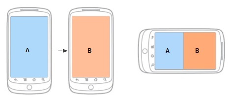

# Gestión de fragmentos independientes en un maestro/detalle

Proyecto básico con `MainActivity`, `FrgLista` (ListView) y `FrgDetalle` (ficha del item).

- **Portrait:** `MainActivity` muestra solo `FrgLista`. Al seleccionar un item se lanza `DetalleActivity` pasando el id en el Intent.
- **Landscape:** `MainActivity` muestra `FrgLista` y `FrgDetalle` a la vez, y todo funciona dentro de la misma activity.

El layout decide el modo: `res/layout/` (portrait) solo contiene la lista, y `res/layout-land/` contiene los dos fragmentos. La `MainActivity` comprueba si el fragmento de detalle existe en pantalla y actúa en consecuencia.



## Estructura

```
java/.../Item.java
java/.../Datos.java
java/.../FrgLista.java
java/.../FrgDetalle.java
java/.../MainActivity.java
java/.../DetalleActivity.java
res/layout/activity_main.xml          (portrait)
res/layout-land/activity_main.xml     (landscape)
res/layout/activity_detalle.xml
res/layout/frg_lista.xml
res/layout/frg_detalle.xml
res/values/strings.xml
AndroidManifest.xml
```

## Modelo

**Item.java**

```java
public class Item {
    public final int id;
    public final String nombre;
    public final String descripcion;

    public Item(int id, String nombre, String descripcion) {
        this.id = id;
        this.nombre = nombre;
        this.descripcion = descripcion;
    }

    @Override public String toString() { return nombre; }
}
```

**Datos.java**

```java
import java.util.ArrayList;
import java.util.List;

public class Datos {
    private static final List<Item> ITEMS = new ArrayList<>();
    static {
        ITEMS.add(new Item(0, "Manzana", "Fruta dulce y crujiente."));
        ITEMS.add(new Item(1, "Pera", "Fruta jugosa de piel fina."));
        ITEMS.add(new Item(2, "Naranja", "Cítrico rico en vitamina C."));
        ITEMS.add(new Item(3, "Plátano", "Fruta tropical muy energética."));
    }

    public static List<Item> getItems() { return ITEMS; }

    public static Item getItem(int id) {
        for (Item i : ITEMS)
            if (i.id == id) return i;
        return null;
    }
}
```

## FrgLista

El fragmento no conoce a la activity: solo expone una interfaz que ella implementa.

```java
import android.content.Context;
import android.os.Bundle;
import android.view.LayoutInflater;
import android.view.View;
import android.view.ViewGroup;
import android.widget.ArrayAdapter;
import android.widget.ListView;

import androidx.annotation.NonNull;
import androidx.annotation.Nullable;
import androidx.fragment.app.Fragment;

public class FrgLista extends Fragment {

    public interface OnItemSeleccionadoListener {
        void onItemSeleccionado(int id);
    }

    private OnItemSeleccionadoListener listener;

    @Override
    public void onAttach(@NonNull Context context) {
        super.onAttach(context);
        if (context instanceof OnItemSeleccionadoListener) {
            listener = (OnItemSeleccionadoListener) context;
        } else {
            throw new IllegalStateException(
                context.getClass().getSimpleName() + " debe implementar OnItemSeleccionadoListener");
        }
    }

    @Override
    public void onDetach() {
        super.onDetach();
        listener = null;
    }

    @Nullable
    @Override
    public View onCreateView(@NonNull LayoutInflater inflater, @Nullable ViewGroup container,
                             @Nullable Bundle savedInstanceState) {
        return inflater.inflate(R.layout.frg_lista, container, false);
    }

    @Override
    public void onViewCreated(@NonNull View view, @Nullable Bundle savedInstanceState) {
        ListView lv = view.findViewById(R.id.listView);
        ArrayAdapter<Item> adapter = new ArrayAdapter<>(
                requireContext(), android.R.layout.simple_list_item_1, Datos.getItems());
        lv.setAdapter(adapter);
        lv.setOnItemClickListener((parent, v, position, id) -> {
            Item item = adapter.getItem(position);
            if (item != null && listener != null) listener.onItemSeleccionado(item.id);
        });
    }
}
```

## FrgDetalle

Recibe el id por `arguments` (con `newInstance`) o mediante `mostrar(id)` cuando ya está en pantalla.

```java
import android.os.Bundle;
import android.view.LayoutInflater;
import android.view.View;
import android.view.ViewGroup;
import android.widget.TextView;

import androidx.annotation.NonNull;
import androidx.annotation.Nullable;
import androidx.fragment.app.Fragment;

public class FrgDetalle extends Fragment {

    private static final String ARG_ID = "id";
    private static final int SIN_SELECCION = -1;

    private int idActual = SIN_SELECCION;
    private TextView txtNombre, txtDescripcion;

    public static FrgDetalle newInstance(int id) {
        FrgDetalle f = new FrgDetalle();
        Bundle args = new Bundle();
        args.putInt(ARG_ID, id);
        f.setArguments(args);
        return f;
    }

    @Nullable
    @Override
    public View onCreateView(@NonNull LayoutInflater inflater, @Nullable ViewGroup container,
                             @Nullable Bundle savedInstanceState) {
        return inflater.inflate(R.layout.frg_detalle, container, false);
    }

    @Override
    public void onViewCreated(@NonNull View view, @Nullable Bundle savedInstanceState) {
        txtNombre = view.findViewById(R.id.txtNombre);
        txtDescripcion = view.findViewById(R.id.txtDescripcion);

        if (savedInstanceState != null) {
            idActual = savedInstanceState.getInt(ARG_ID, SIN_SELECCION);
        } else if (getArguments() != null) {
            idActual = getArguments().getInt(ARG_ID, SIN_SELECCION);
        }
        mostrar(idActual);
    }

    /** Se puede llamar desde fuera cuando el fragmento ya está visible. */
    public void mostrar(int id) {
        idActual = id;
        Item item = Datos.getItem(id);
        if (txtNombre == null) return;
        if (item == null) {
            txtNombre.setText(R.string.selecciona_item);
            txtDescripcion.setText("");
        } else {
            txtNombre.setText(item.nombre);
            txtDescripcion.setText(item.descripcion);
        }
    }

    @Override
    public void onSaveInstanceState(@NonNull Bundle outState) {
        super.onSaveInstanceState(outState);
        outState.putInt(ARG_ID, idActual);
    }
}
```

## MainActivity

```java
import android.content.Intent;
import android.os.Bundle;

import androidx.appcompat.app.AppCompatActivity;

public class MainActivity extends AppCompatActivity
        implements FrgLista.OnItemSeleccionadoListener {

    @Override
    protected void onCreate(Bundle savedInstanceState) {
        super.onCreate(savedInstanceState);
        setContentView(R.layout.activity_main);
    }

    @Override
    public void onItemSeleccionado(int id) {
        FrgDetalle detalle = (FrgDetalle) getSupportFragmentManager()
                .findFragmentById(R.id.frgDetalle);

        if (detalle != null) {
            // Landscape: el detalle está en pantalla, solo lo actualizamos
            detalle.mostrar(id);
        } else {
            // Portrait: lanzamos la activity de detalle con el id en el Intent
            Intent intent = new Intent(this, DetalleActivity.class);
            intent.putExtra(DetalleActivity.EXTRA_ID, id);
            startActivity(intent);
        }
    }
}
```

## DetalleActivity

Si el usuario gira a landscape estando aquí, se cierra y vuelve a la `MainActivity`, que ya muestra los dos fragmentos.

```java
import android.content.res.Configuration;
import android.os.Bundle;

import androidx.appcompat.app.AppCompatActivity;

public class DetalleActivity extends AppCompatActivity {

    public static final String EXTRA_ID = "id";

    @Override
    protected void onCreate(Bundle savedInstanceState) {
        super.onCreate(savedInstanceState);

        if (getResources().getConfiguration().orientation == Configuration.ORIENTATION_LANDSCAPE) {
            finish();
            return;
        }

        setContentView(R.layout.activity_detalle);

        if (savedInstanceState == null) {
            int id = getIntent().getIntExtra(EXTRA_ID, -1);
            getSupportFragmentManager().beginTransaction()
                    .replace(R.id.contenedorDetalle, FrgDetalle.newInstance(id))
                    .commit();
        }
    }
}
```

### Explicación del onCreate de DetalleActivity

**`super.onCreate(savedInstanceState)`**: es obligatorio. Deja que Android y AppCompat hagan su inicialización, y además restaura el estado de los fragmentos si la activity se está recreando (por ejemplo, tras una rotación).

**Comprobación de orientación**: esta activity solo tiene sentido en portrait, porque en landscape la `MainActivity` ya muestra lista y detalle a la vez. Si el usuario está viendo el detalle en portrait y gira el móvil, Android destruye y recrea `DetalleActivity`, y en ese `onCreate` la orientación ya es landscape. Entonces se llama a `finish()` para cerrarla y se vuelve a la `MainActivity` que está debajo en la pila, que cargará `layout-land` con los dos paneles. El `return` evita seguir ejecutando el resto del método, porque no hay que montar un layout en una activity que ya se está cerrando.

Sin el `return`, el método continuaría: inflaría el layout, haría el `getIntent()` y lanzaría la transacción del fragmento en una activity que ya está marcada para destruirse. No daría error, pero sería trabajo inútil, y en algunos casos puede provocar problemas (por ejemplo, transacciones de fragmentos sobre una activity que se está cerrando).

Respecto al ciclo de vida, cuando llamas a finish() dentro de onCreate, Android deja terminar onCreate y salta directamente a onDestroy(). No llegan a ejecutarse onStart() ni onResume(), así que el usuario ni siquiera llega a ver la activity.

**`setContentView(R.layout.activity_detalle)`**: infla el layout, que es solo un `FrameLayout` vacío con id `contenedorDetalle`. Ahí dentro se colocará el fragmento.

**`if (savedInstanceState == null)`**: es la parte más importante. `savedInstanceState` es `null` solo la primera vez que se crea la activity. Si es una recreación (por ejemplo, el usuario cambia el idioma o el tamaño de fuente del sistema sin llegar a landscape), el `FragmentManager` ya ha restaurado por su cuenta el `FrgDetalle` anterior, con sus `arguments` incluidos. Si se volviera a hacer el `replace` sin esta condición, se crearía un fragmento nuevo cada vez y se perdería el estado.

**Dentro del `if`**:

- `getIntent().getIntExtra(EXTRA_ID, -1)` lee el id que puso `MainActivity` en el Intent.
- `FrgDetalle.newInstance(id)` crea el fragmento y le pasa el id por `arguments`. Así el fragmento no depende del Intent ni de esta activity, y es reutilizable.
- `beginTransaction().replace(...).commit()` coloca el fragmento dentro del contenedor. Se usa `replace` en lugar de `add` porque es lo más seguro: si ya hubiera algo en el contenedor, lo sustituye en vez de apilarse encima.

El flujo completo en portrait es: `MainActivity` detecta el click, lanza el Intent con el id, `DetalleActivity` lo lee en `onCreate` y se lo entrega al fragmento mediante `newInstance`.


## Layouts

**res/layout/activity_main.xml** (portrait: solo la lista)

```xml
<?xml version="1.0" encoding="utf-8"?>
<androidx.fragment.app.FragmentContainerView
    xmlns:android="http://schemas.android.com/apk/res/android"
    android:id="@+id/frgLista"
    android:name="com.example.masterdetail.FrgLista"
    android:layout_width="match_parent"
    android:layout_height="match_parent" />
```

**res/layout-land/activity_main.xml** (landscape: los dos)

```xml
<?xml version="1.0" encoding="utf-8"?>
<LinearLayout xmlns:android="http://schemas.android.com/apk/res/android"
    android:layout_width="match_parent"
    android:layout_height="match_parent"
    android:orientation="horizontal">

    <androidx.fragment.app.FragmentContainerView
        android:id="@+id/frgLista"
        android:name="com.example.masterdetail.FrgLista"
        android:layout_width="0dp"
        android:layout_height="match_parent"
        android:layout_weight="1" />

    <androidx.fragment.app.FragmentContainerView
        android:id="@+id/frgDetalle"
        android:name="com.example.masterdetail.FrgDetalle"
        android:layout_width="0dp"
        android:layout_height="match_parent"
        android:layout_weight="2" />
</LinearLayout>
```

**res/layout/activity_detalle.xml**

```xml
<?xml version="1.0" encoding="utf-8"?>
<FrameLayout xmlns:android="http://schemas.android.com/apk/res/android"
    android:id="@+id/contenedorDetalle"
    android:layout_width="match_parent"
    android:layout_height="match_parent" />
```

**res/layout/frg_lista.xml**

```xml
<?xml version="1.0" encoding="utf-8"?>
<ListView xmlns:android="http://schemas.android.com/apk/res/android"
    android:id="@+id/listView"
    android:layout_width="match_parent"
    android:layout_height="match_parent" />
```

**res/layout/frg_detalle.xml**

```xml
<?xml version="1.0" encoding="utf-8"?>
<LinearLayout xmlns:android="http://schemas.android.com/apk/res/android"
    android:layout_width="match_parent"
    android:layout_height="match_parent"
    android:orientation="vertical"
    android:padding="16dp">

    <TextView
        android:id="@+id/txtNombre"
        android:layout_width="match_parent"
        android:layout_height="wrap_content"
        android:textSize="24sp"
        android:textStyle="bold" />

    <TextView
        android:id="@+id/txtDescripcion"
        android:layout_width="match_parent"
        android:layout_height="wrap_content"
        android:layout_marginTop="12dp"
        android:textSize="16sp" />
</LinearLayout>
```

## Recursos y configuración

**res/values/strings.xml** (añadir)

```xml
<string name="selecciona_item">Selecciona un elemento</string>
```

**AndroidManifest.xml** (declarar la segunda activity)

```xml
<activity android:name=".DetalleActivity" android:exported="false" />
```

**build.gradle (app)**: hacen falta `androidx.appcompat:appcompat` y `androidx.fragment:fragment` (normalmente ya vienen en la plantilla).

Ajusta el nombre del paquete (`com.example.masterdetail`) en los `android:name` de los layouts al de tu proyecto.

## Por qué los fragmentos no dependen del entorno

- `FrgLista` solo habla con su `OnItemSeleccionadoListener`; no sabe si hay otro fragmento ni qué activity lo aloja.
- `FrgDetalle` recibe el id por `arguments` o por `mostrar(id)`, y no lee el Intent de ninguna activity.
- Quien decide qué hacer (actualizar el detalle o lanzar otra activity) es la `MainActivity`, según qué layout se haya cargado: si existe `frgDetalle`, hay panel doble.

## Nota: conservar la selección al rotar

Al rotar de portrait a landscape desde `DetalleActivity`, el elemento seleccionado no se transfiere a la vista doble. Para conservarlo, `DetalleActivity` puede devolver el id (con `setResult`) o se puede guardar la selección en un `ViewModel` compartido.
