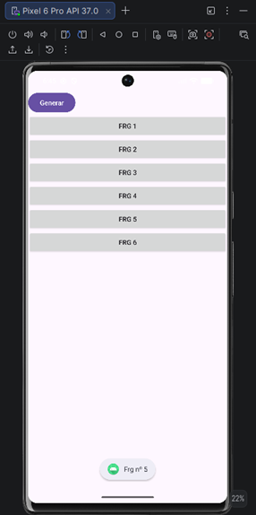
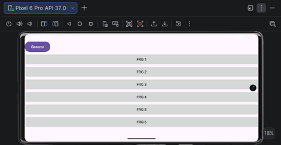

# Fragmentos: gestión dinámica

## 1. Introducción

- Un fragmento declarado en el layout con `<fragment>` (estático) **no se puede eliminar ni reemplazar** en tiempo de ejecución.
- Para añadir, quitar o reemplazar fragmentos dinámicamente se usa una **`FragmentTransaction`**, que se obtiene con `fm.beginTransaction()`.
- Hace falta un **contenedor** (`View`) donde alojar el fragmento. Una opción sencilla es un `FrameLayout`.
- Una misma transacción puede agrupar varias operaciones: `add(int, Fragment)`, `remove(Fragment)` y `replace(int, Fragment)`.
- Los cambios solo se aplican al llamar a **`commit()`**.
- El ejemplo crea 3 fragmentos (cada uno con un botón) al pulsar "Generar". Cada fragmento va en un `FragmentContainerView` creado por código.


<!--

## 2. Observaciones sobre el texto

| Afirmación del apartado | Matiz o mejora |
|---|---|
| Declarar con `<fragment>` | La etiqueta `<fragment>` está obsoleta. Se recomienda `FragmentContainerView` con el atributo `android:name`. |
| "No se podrá eliminar" | Es cierto para `<fragment>`. Con `FragmentContainerView` + `android:name` el fragmento se añade con una transacción normal; conviene comprobar el comportamiento con la versión de `androidx.fragment` que se use. |
| "Un `FrameLayout` es el contenedor más sencillo" | Hoy el contenedor recomendado es `FragmentContainerView`, que gestiona mejor animaciones y *window insets*. |
| Solo menciona `add`, `remove` y `replace` | Faltan `hide`/`show`, `attach`/`detach`, `addToBackStack`, `setCustomAnimations`, `setReorderingAllowed`. |
| "Al final un `commit()`" | Faltan las variantes y sus efectos (ver apartado 5). |
| Typo | "tendremos que crear utilizar" → "tendremos que utilizar". |


## 3. Problemas del código de ejemplo

### Críticos

1. **Se acumulan fragmentos en cada clic.** Cada vez que se pulsa se añaden 5 más. Con `removeAllViews()` descomentado (línea `//llContenedorFrgs.removeAllViews();`) se quitarían los contenedores, **pero los fragmentos seguirían vivos dentro del `FragmentManager`** (fuga de memoria).
2. **Los contenedores dinámicos no sobreviven a una recreación** (girar la pantalla, cambio de tema, etc.). Sus IDs vienen de `View.generateViewId()`, que no se conserva. El `FragmentManager` restaura los fragmentos, pero el contenedor ya no existe y pueden quedar vivos sin vista visible.
3. **El `id` del fragmento depende de un contador `static`.**
   - Nunca se reinicia, así que al pulsar dos veces los números pasan de 1–5 a 6–10.
   - El sistema recrea los fragmentos con el constructor vacío (por reflexión), de modo que el contador vuelve a incrementarse y los números cambian.
   - Los datos de un fragmento deben pasarse con **`setArguments(Bundle)`**, que sí se conserva.

### Menores

- `getActivity()` puede devolver `null`. Usar `requireContext()` o `inflater.getContext()`.
- Nombrar el campo `id` confunde: `Fragment` ya tiene el método `getId()` (el ID del contenedor). Mejor `numero`.
- Sin etiquetas (*tags*) no hay forma de localizar o quitar un fragmento concreto después (`findFragmentByTag`).
- Falta `setReorderingAllowed(true)`, recomendado para optimizar las transacciones.
- Textos *hardcodeados* (`"Generar"`, `"Frg "+id`): llevarlos a `strings.xml`.
- Las clases anónimas (`new View.OnClickListener() {...}`) se pueden sustituir por lambdas.
- Convenciones de nombres: los métodos `Clic()` y `ClicBoton()` deberían ir en minúscula (`onGenerarClick`, `clicBoton`) y `Frg` es poco descriptivo (`BotonFragment`).
- El contenedor del layout no tiene scroll: con muchos fragmentos no caben. Añadir un `ScrollView`.
- Si `getNumFrgs()` consulta una base de datos (como sugiere el comentario), **no debe hacerse en el hilo principal**.

-->

## 2. Ejemplo de creación dinámica

Cada clic en "Generar" **añade** fragmentos nuevos sin quitar los anteriores, y el número continúa desde donde iba (1 a 3, luego 4 a 6, etc.).

Hay que guardar al girar la pantalla

- **El contador**, para que los números sigan desde donde iban.
- **Los IDs de los contenedores**, para recrearlos con el mismo ID. Los fragmentos que restaura el `FragmentManager` buscan su contenedor por ese ID, y `generateViewId()` daría IDs nuevos.


  


### `res/layout/activity_main.xml`

```xml
<?xml version="1.0" encoding="utf-8"?>
<LinearLayout xmlns:android="http://schemas.android.com/apk/res/android"
    xmlns:tools="http://schemas.android.com/tools"
    android:id="@+id/main"
    android:layout_width="match_parent"
    android:layout_height="match_parent"
    android:orientation="vertical"
    tools:context=".MainActivity">

    <Button
        android:id="@+id/btnGenerar"
        android:layout_width="wrap_content"
        android:layout_height="wrap_content"
        android:text="@string/generar" />

    <ScrollView
        android:layout_width="match_parent"
        android:layout_height="0dp"
        android:layout_weight="1">

        <LinearLayout
            android:id="@+id/llContenedorFrgs"
            android:layout_width="match_parent"
            android:layout_height="wrap_content"
            android:orientation="vertical" />
    </ScrollView>
</LinearLayout>
```

### `res/values/strings.xml`

```xml
<string name="generar">Generar</string>
<string name="frg_titulo">Frg %1$d</string>
<string name="frg_toast">Frg nº %1$d</string>
```

### `BotonFragment.java`

```java
public class BotonFragment extends Fragment {

    private static final String ARG_NUMERO = "numero";
    private int numero;

    public BotonFragment() { } // constructor vacío obligatorio

    public static BotonFragment newInstance(int numero) {
        BotonFragment f = new BotonFragment();
        Bundle args = new Bundle();
        args.putInt(ARG_NUMERO, numero);
        f.setArguments(args);          // sobrevive a la recreación
        return f;
    }

    @Override
    public void onCreate(@Nullable Bundle savedInstanceState) {
        super.onCreate(savedInstanceState);
        numero = requireArguments().getInt(ARG_NUMERO);
    }

    @Nullable
    @Override
    public View onCreateView(@NonNull LayoutInflater inflater,
                             @Nullable ViewGroup container,
                             @Nullable Bundle savedInstanceState) {
        Button b = new Button(inflater.getContext());
        b.setText(getString(R.string.frg_titulo, numero));
        b.setOnClickListener(v -> clicBoton());
        return b;
    }

    private void clicBoton() {
        Toast.makeText(requireContext(),
                getString(R.string.frg_toast, numero),
                Toast.LENGTH_SHORT).show();
    }
}
```

## `MainActivity.java`

```java
public class MainActivity extends AppCompatActivity {

    private static final String TAG_PREFIJO = "frg_";
    private static final String KEY_CONTADOR = "contador";
    private static final String KEY_IDS = "idsContenedores";

    private LinearLayout llContenedorFrgs;
    private FragmentManager fm;

    private int contador = 0;                                   // último número usado
    private final ArrayList<Integer> idsContenedores = new ArrayList<>();

    @Override
    protected void onCreate(Bundle savedInstanceState) {
        super.onCreate(savedInstanceState);
        setContentView(R.layout.activity_main);
        View root = findViewById(R.id.main);
        ViewCompat.setOnApplyWindowInsetsListener(root, (v, insets) -> {
            Insets barras = insets.getInsets(WindowInsetsCompat.Type.systemBars());
            v.setPadding(barras.left, barras.top, barras.right, barras.bottom);
            return insets;
        });

        llContenedorFrgs = findViewById(R.id.llContenedorFrgs);
        fm = getSupportFragmentManager();

        // Tras girar la pantalla: recuperar contador y recrear los contenedores
        // con los mismos IDs. Los fragmentos los restaura solo el FragmentManager.
        if (savedInstanceState != null) {
            contador = savedInstanceState.getInt(KEY_CONTADOR, 0);
            ArrayList<Integer> ids = savedInstanceState.getIntegerArrayList(KEY_IDS);
            if (ids != null) {
                for (int id : ids) {
                    crearContenedor(id);
                }
            }
        }

        findViewById(R.id.btnGenerar).setOnClickListener(v -> generarFragmentos());
    }

    @Override
    protected void onSaveInstanceState(@NonNull Bundle outState) {
        super.onSaveInstanceState(outState);
        outState.putInt(KEY_CONTADOR, contador);
        outState.putIntegerArrayList(KEY_IDS, idsContenedores);
    }

    private int getNumFrgs() {
        return 3; // p. ej. consulta a BD (fuera del hilo principal)
    }

    private void crearContenedor(int id) {
        FragmentContainerView fcv = new FragmentContainerView(this);
        fcv.setId(id);
        llContenedorFrgs.addView(fcv);
        idsContenedores.add(id);
    }

    private void generarFragmentos() {
        FragmentTransaction ft = fm.beginTransaction().setReorderingAllowed(true);
        for (int i = 1; i <= getNumFrgs(); i++) {
            contador++;
            int id = View.generateViewId();
            crearContenedor(id);
            ft.add(id, BotonFragment.newInstance(contador), TAG_PREFIJO + contador);
        }
        ft.commit();
    }
}
```

<!--

## 5. Más mejoras y buenas prácticas

### Otras operaciones de `FragmentTransaction`

- `hide()` / `show()`: ocultan o muestran sin destruir la vista.
- `attach()` / `detach()`: destruyen la vista pero conservan el fragmento.
- `addToBackStack(nombre)`: permite volver atrás con el botón de retroceso.
- `setCustomAnimations(...)`: animaciones de entrada y salida.
- `runOnCommit(Runnable)`: código tras aplicar la transacción.

### Comunicación y estado

- Entre fragmentos y actividad: **`ViewModel` compartido** (`new ViewModelProvider(requireActivity())`) o la **Fragment Result API** (`setFragmentResult` / `setFragmentResultListener`).
- Evita llamar a métodos de la actividad con un cast (`(MainActivity) getActivity()`): crea acoplamiento fuerte.
- Si el número de fragmentos viene de una BD, carga los datos en un `ViewModel` con `LiveData`, para que el resultado llegue con el ciclo de vida respetado y no se haga `commit` en un estado no válido.
- Para fragmentos anidados, usa `getChildFragmentManager()`.

### Alternativas de diseño según el caso

- **Lista de N elementos iguales visibles a la vez:** `RecyclerView` con un adaptador. Es mucho más ligero que un fragmento por elemento.
- **N páginas o pestañas, una visible cada vez:** `ViewPager2` + `FragmentStateAdapter`.
- **Navegación entre pantallas:** Navigation Component (`NavHostFragment` + grafo de navegación).
- **Fragmento fijo en el layout:** `FragmentContainerView` con `android:name`, en lugar de `<fragment>`.
- **Layout propio por fragmento:** usar el constructor `Fragment(@LayoutRes int)` y evitar crear la vista a mano.

## 6. Notas a tener en cuenta

- [ ] Contenedor: `FragmentContainerView`, no `<fragment>` ni `FrameLayout` suelto.
- [ ] Datos del fragmento por `setArguments`, nunca por campos `static` ni por constructor con parámetros.
- [ ] `setReorderingAllowed(true)` en cada transacción.
- [ ] Etiquetas (`tag`) para localizar fragmentos.
- [ ] Al eliminar vistas, eliminar también los fragmentos en el `FragmentManager`.
- [ ] Comprobar el comportamiento al girar la pantalla.
- [ ] Sin `commit()` tras `onSaveInstanceState`.
- [ ] Textos en `strings.xml` y lambdas en los listeners.

-->
